# Design: screens and wireframes

| | |
|---|---|
| **Belongs in** | Design (before and during build) |
| **Written** | Nov 2026 (reconstructed after build) |
| **Evidence** | The deployed app, captured Nov 2026 |
| **Confidence** | Observed |

Also see [`user-journey.md`](user-journey.md) for the flows.

## How to read the images

- **Screenshots** are the real app. Business names, phone numbers, emails, the test account email and the tester's location are **blurred**. The data is one internal test run, not customer data.
- **Wireframes** are low-fidelity layouts reconstructed from the as-built screens. They were drawn after the build, not before it.

## Design system (observed)

Clinical teal and cyan accents on soft glass surfaces; Space Grotesk for headings and Inter for text; light and dark themes; status colours for the four tiers (green Ready, amber Review, orange Low, red Skip).

## Screens

### 1. Intelligence (home)
Stats cards, tier bar, filters and the ranked account list.

| Screenshot | Wireframe |
|---|---|
| 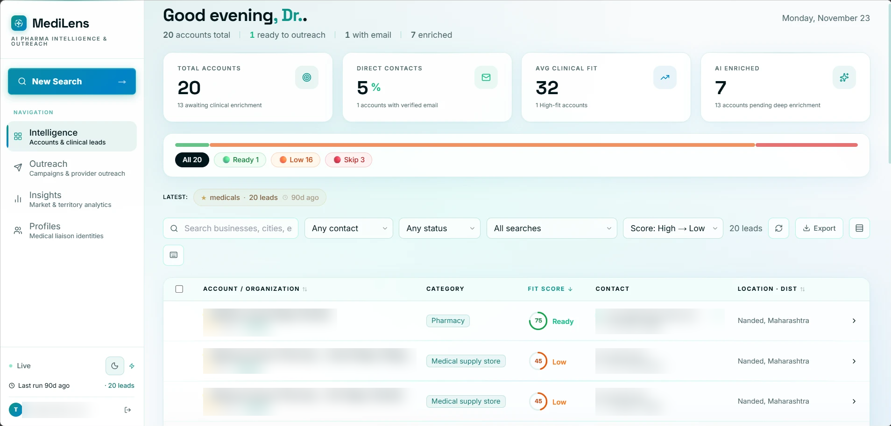 | 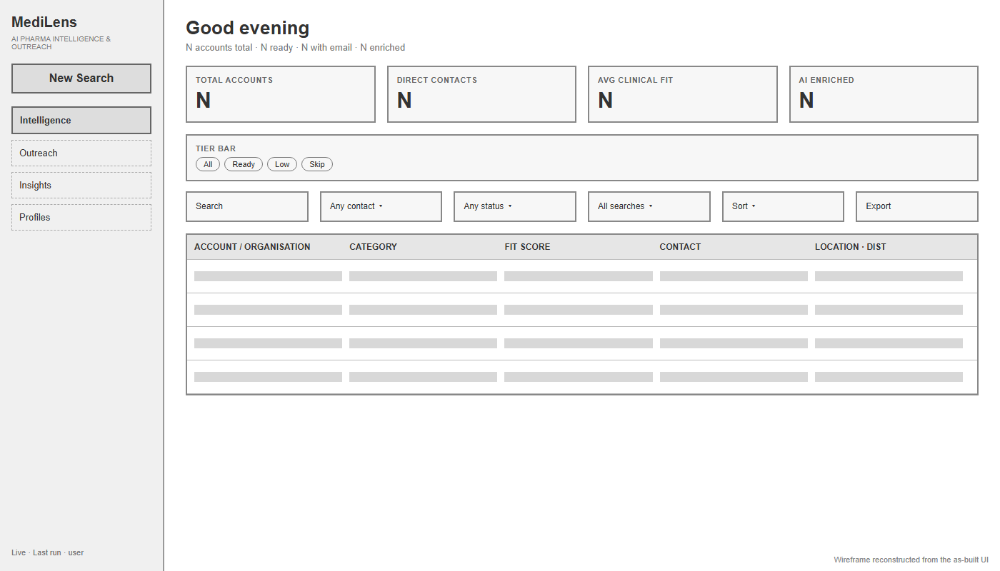 |

### 2. New search
Near me or anywhere, sector, radius, recent runs and the map.

| Screenshot | Wireframe |
|---|---|
| 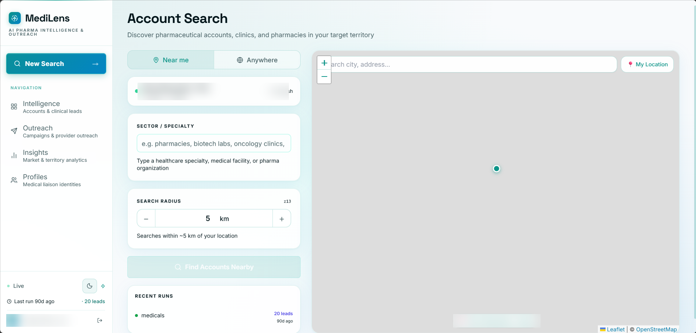 | 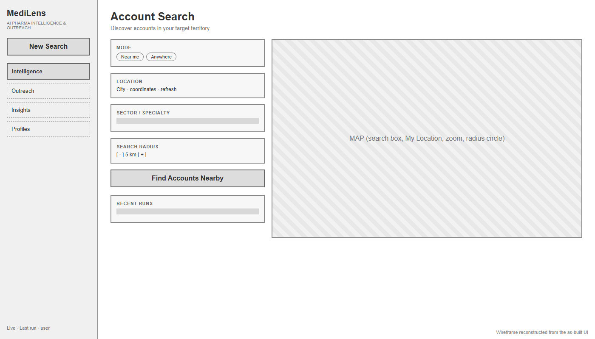 |

### 3. Account detail panel
Score, actions (Re-Enrich, Deep Enrich, Outreach), tabs and business details.

| Screenshot | Wireframe |
|---|---|
| 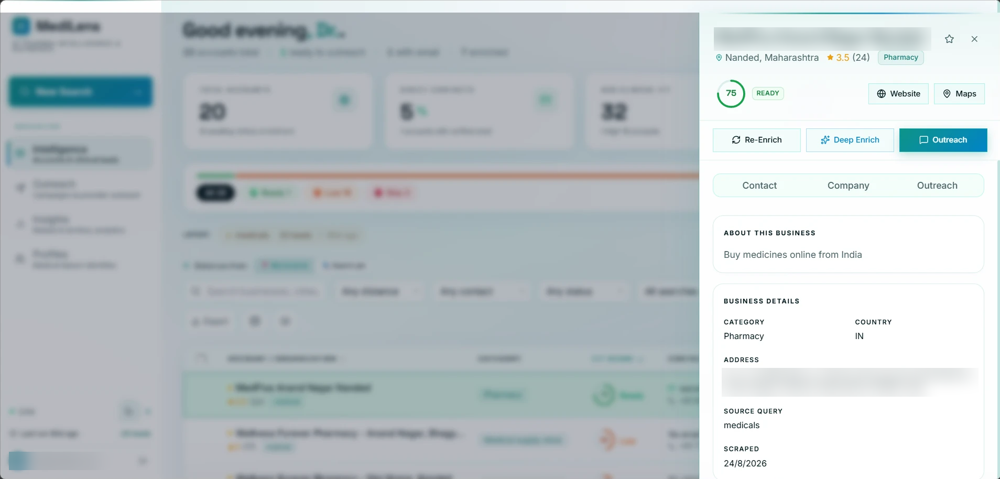 | 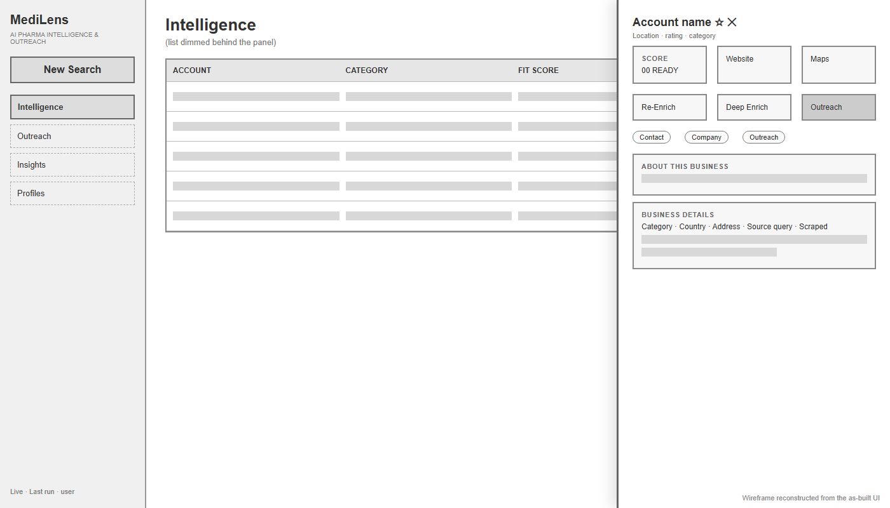 |

### 4. Outreach pipeline
Message counts, channel and tone mix, drafts ready to send.

| Screenshot | Wireframe |
|---|---|
| 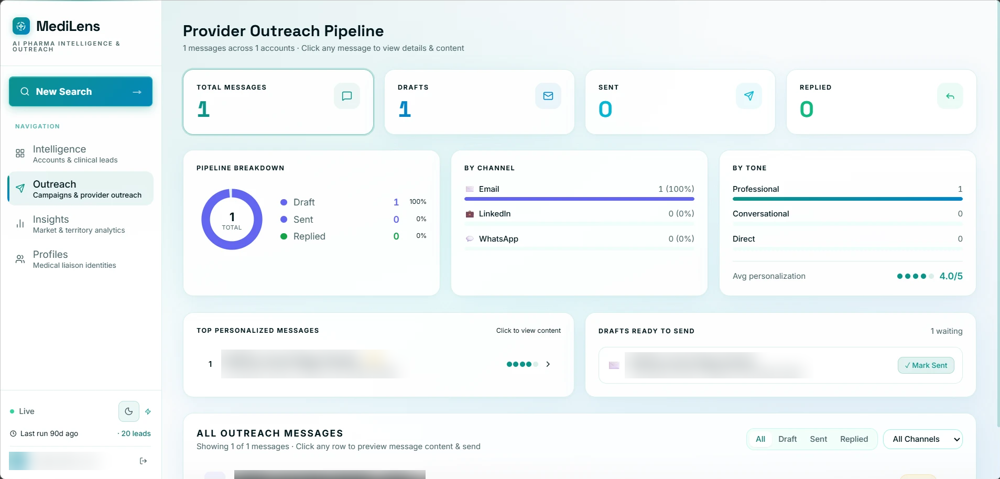 | 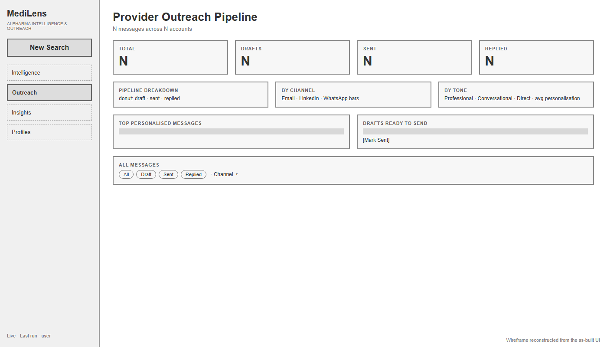 |

*Note: the single draft in this test is the generic fallback template, so the 4.0 average personalisation is not a quality signal (see limitation L-04).*

### 5. Territory insights
Average score, tier breakdown, quality distribution, sector and geography.

| Screenshot | Wireframe |
|---|---|
| 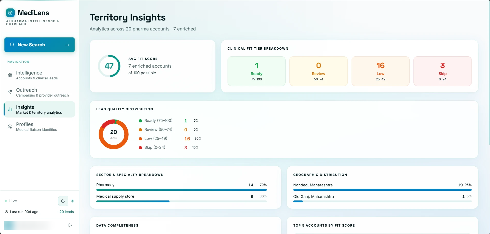 | 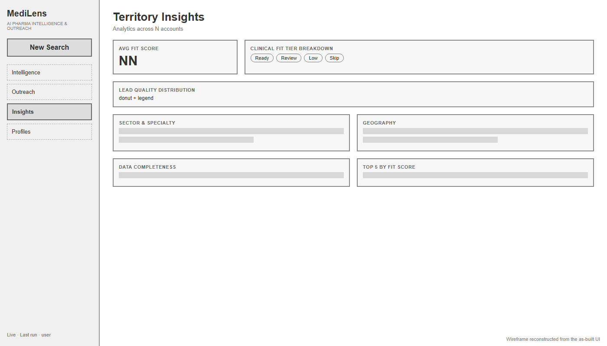 |

### 6. Liaison profiles
Named sender identities with a pitch and audience.

| Screenshot | Wireframe |
|---|---|
| 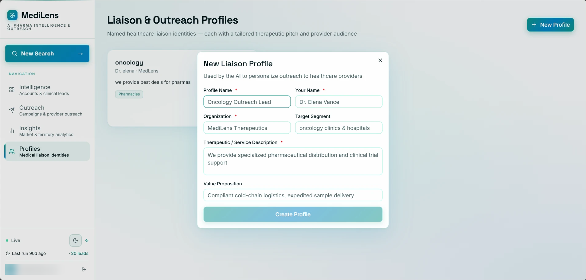 | 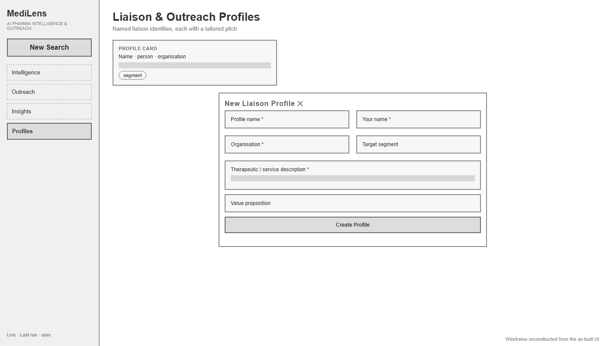 |

*The profile in this screenshot (a named doctor at a "therapeutics" company) is made-up demo text.*

## Design observations

**Works:** the tier colours make the list scannable; one score everywhere; the detail panel keeps context; empty states show zeros instead of errors.

**To improve** (from [`known-limitations.md`](../06-quality-launch/known-limitations.md)): the greeting shows "Dr.." with a doubled full stop; the map zoom buttons cover the start of the search box text; the two "average" figures should say what they average; fallback drafts need a visible warning.
