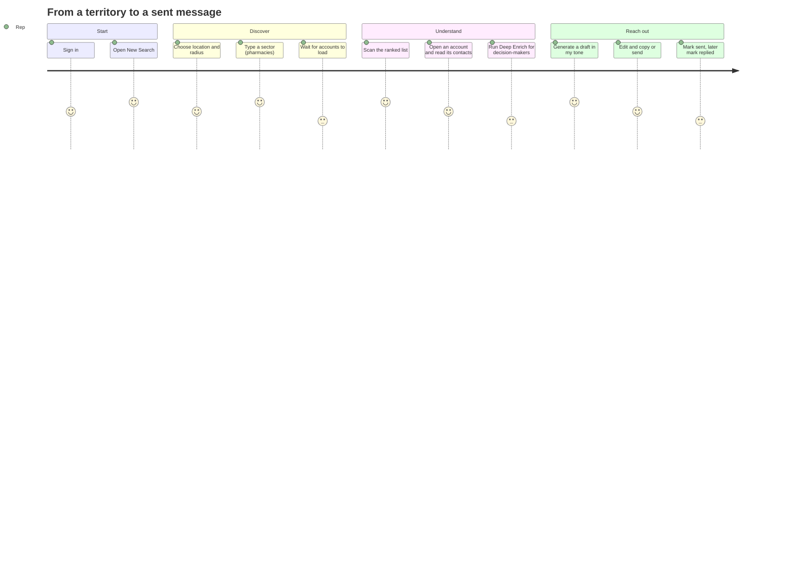
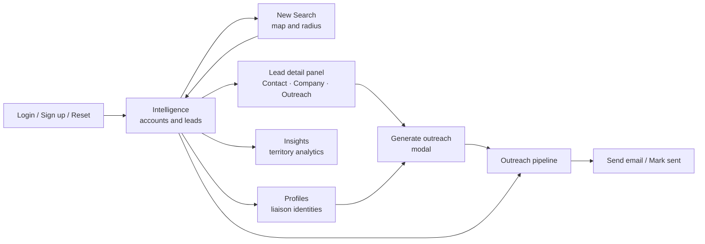

# User journey and flows

| | |
|---|---|
| **Belongs in** | Design (before build) |
| **Written** | Nov 2026 (reconstructed after build) |
| **Evidence** | Deployed app, screenshots, page routes in the code |
| **Confidence** | Observed |

## 1. The core journey (territory rep)

*Scores are the PM's expectation of how the step feels (1 low, 5 high). They are hypotheses to test in interviews, not measured data.*

## 2. Screen flow

## 3. Decision points in the flow

| Where | Decision | What the product does |
|---|---|---|
| After search | Is the account worth contacting? | Shows a 0 to 100 fit score and tier (Ready, Review, Low, Skip) |
| Account has no website | Can it be enriched? | Lowers the score and labels the crawl status |
| Detail panel | Need a named person? | Offers **Deep Enrich** to look for decision-makers |
| Generate outreach | Which voice and channel? | User picks a sender profile, channel and tone |
| Before sending | Is the message right? | Draft stays a draft until the user edits and sends or marks it sent |

## 4. Error and empty states observed

- **No data yet:** pages show zeros (for example Sent 0, Replied 0) instead of failing.
- **Location not detected:** the search page lets the user type a city or address.
- **Crawl blocked or no website:** recorded in the account's crawl status.
- **Mail credentials missing:** the app says the email was not sent and leaves the message as a draft.
