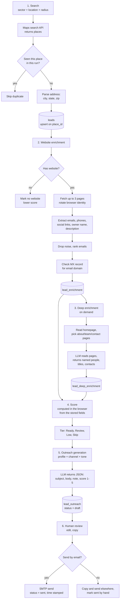

# End-to-end data flow

| | |
|---|---|
| **Belongs in** | Architecture (during build) |
| **Written** | Nov 2026 (reconstructed after build) |
| **Evidence** | Services and API routes in the source code |
| **Confidence** | Observed |

## The pipeline

## Data stores touched at each step

| Step | Reads | Writes |
|---|---|---|
| Search | Search form | `scrape_runs`, `leads` |
| Enrich | `leads` | `lead_enrichment`, `lead_errors` |
| Deep enrich | `leads` | `lead_deep_enrichment` |
| Score | `leads`, `lead_enrichment` | Nothing (computed when the page loads) |
| Generate | `leads`, enrichment, `sender_profiles` | `lead_outreach` |
| Send | `lead_outreach` | `lead_outreach.status` and `sent_at` |

## Personal data in the flow

Steps 2 and 3 can collect names, emails and phone numbers of individuals who published them on a business website. See [`privacy-and-compliance.md`](../06-quality-launch/privacy-and-compliance.md).
