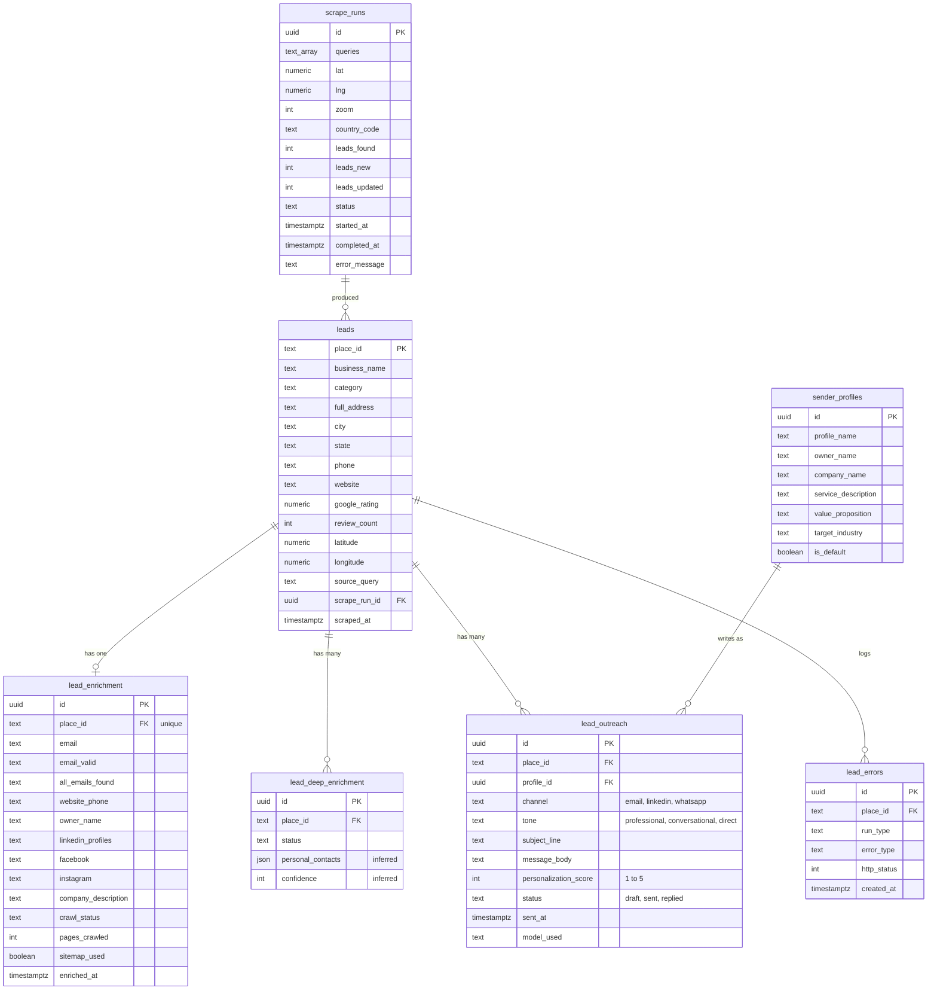

# Data model (ERD)

| | |
|---|---|
| **Belongs in** | Architecture (during build) |
| **Written** | Nov 2026 (reconstructed after build) |
| **Evidence** | `database/schema.sql` and the services that write to the database |
| **Confidence** | Observed, except `lead_deep_enrichment` columns (Derived from code) |

## Entity relationship diagram

## Other objects

| Object | Purpose |
|---|---|
| `enrichment_runs` | Log of enrichment batches (counts, status). No foreign key to other tables. |
| `leads_full` | In the setup script a view that adds the computed score. **In the live database it is an empty plain table**, so the app computes the score in the browser (L-07). |
| `compute_lead_quality_score(...)` | The database scoring function. Present in the setup script; not used by the live app (see [`algorithms.md`](algorithms.md)). |
| `update_updated_at_column()` trigger | Keeps `updated_at` current on leads, enrichment and profiles. |
| `set_outreach_sent_at()` trigger | Sets `sent_at` the first time a message becomes *sent*. |

## Rules enforced by the database

- One account per place (`place_id` primary key).
- One enrichment row per account (unique `place_id`).
- One message per (account, profile, channel): regenerating replaces, it does not duplicate.
- Channel, tone and status can only hold the listed values (check constraints).
- Deleting an account deletes its enrichment and outreach (cascade).

## Gaps found while documenting

- The code reads and writes `lead_deep_enrichment`, but **the original setup script did not create it**. Fixed 23 Nov 2026 by `database/migration_security_hardening.sql`, which is also applied to the live database.
- `leads_full` differs between the setup script (view) and the live database (empty table). Tracked as L-07.
- Access rules added 23 Nov 2026: row-level security on every table, a policy for signed-in users only, no privileges for the public key, and an `allowed_signups` table with a trigger that closes registration to approved emails.
