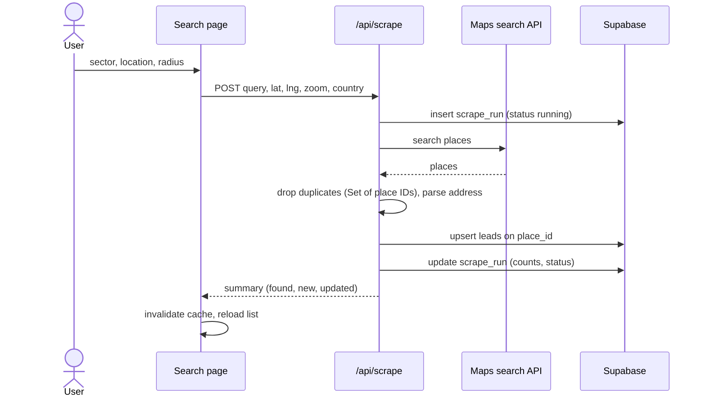
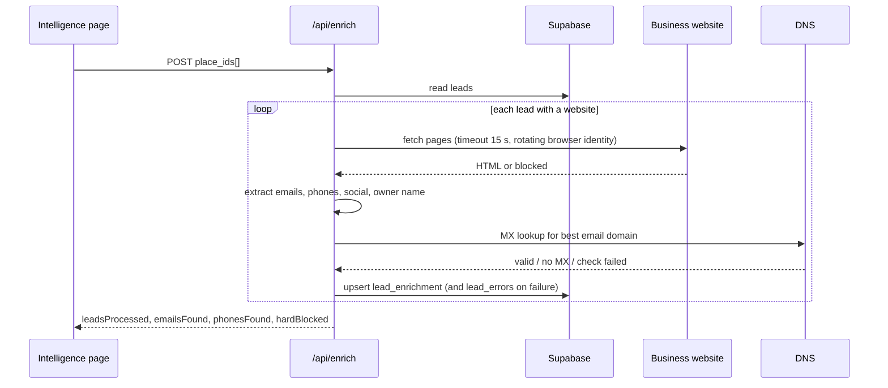
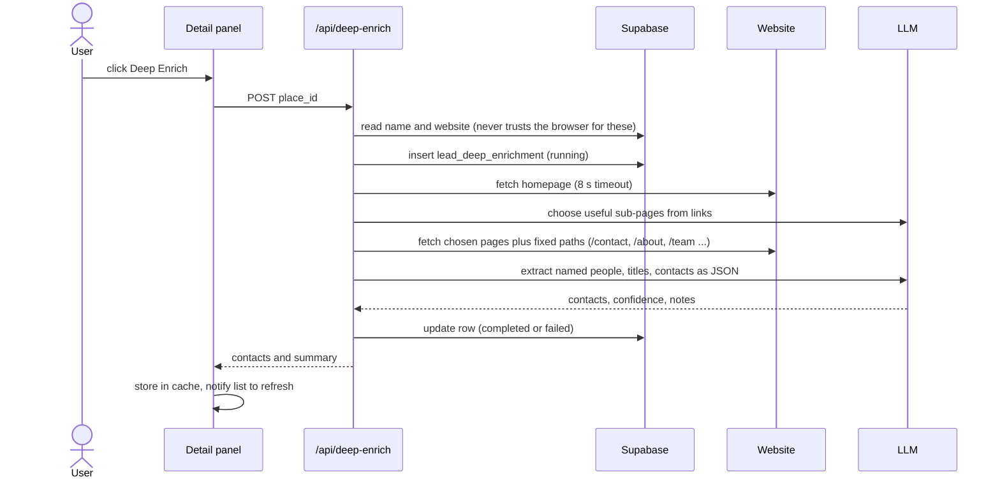
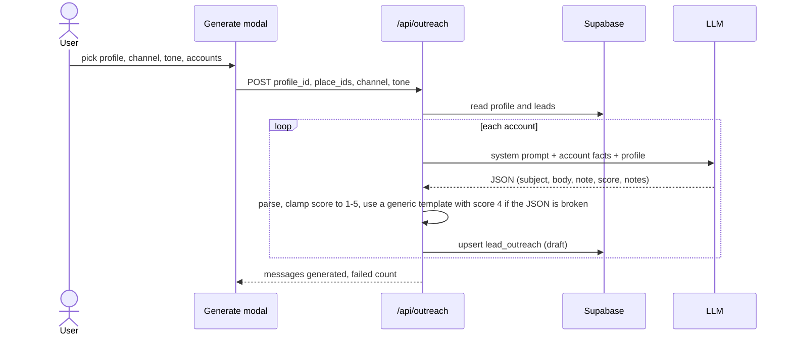
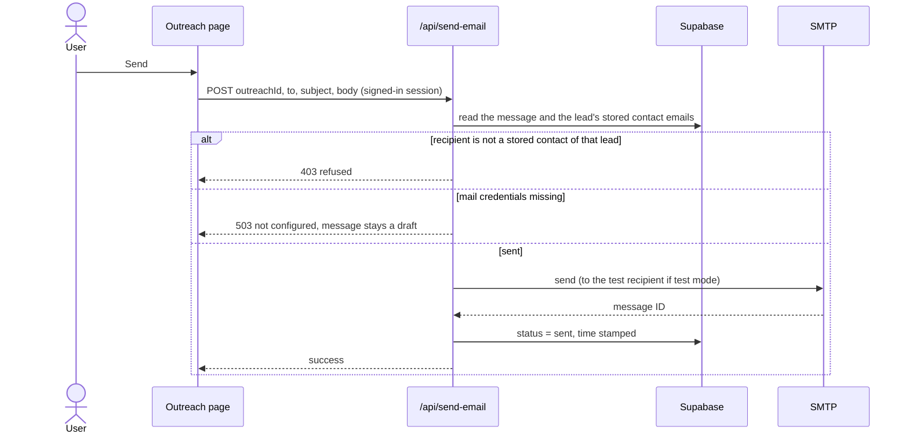

# Sequence diagrams

| | |
|---|---|
| **Belongs in** | Architecture (during build) |
| **Written** | Nov 2026 (reconstructed after build) |
| **Evidence** | API routes and services in the source code |
| **Confidence** | Observed |

## 1. Search and save accounts

## 2. Website enrichment

## 3. Deep enrichment (one account)

## 4. Generate outreach

## 5. Send email

