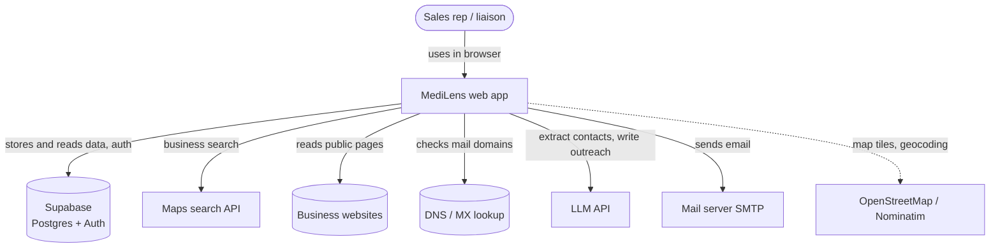
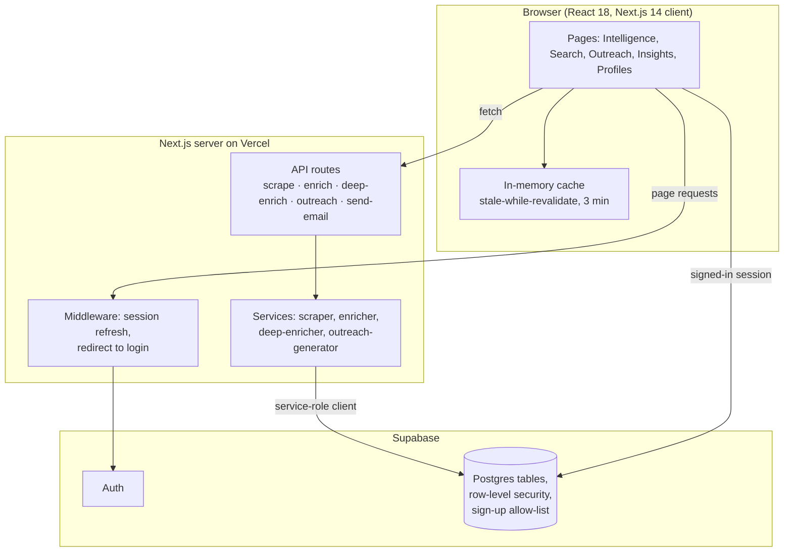

# System architecture

| | |
|---|---|
| **Belongs in** | Architecture (during build) |
| **Written** | Nov 2026 (reconstructed after build) |
| **Evidence** | Source code, database schema, deployed app |
| **Confidence** | Observed |

## 1. Context (who and what the system talks to)

## 2. Containers

## 3. Technology choices

| Layer | Choice | Why (PM view) |
|---|---|---|
| App | Next.js 14 (App Router), TypeScript | One codebase for pages and server endpoints; typed contracts |
| Data and auth | Supabase (Postgres, SSR auth) | Fast to start; managed auth and database. Since 23 Nov 2026 every table has row-level security with a signed-in-users policy, the public key has no access and sign-ups are closed. |
| Scoring | Browser formula in the live app (a richer SQL function exists in the setup script) | Fast to ship; two formulas now need to become one (L-07) |
| AI | An LLM API for contact extraction and message writing | Structured JSON output; low cost during validation |
| Maps | Leaflet with OpenStreetMap, a maps search API | No map-tile cost; place data with phone, rating, coordinates |
| Mail | SMTP through a mail account | Simplest send path for a prototype |
| Hosting | Vercel | Matches the framework; free tier for a prototype |

## 4. Design principles visible in the code

1. **Server-side secrets.** API keys and the database service key are used only in server code.
2. **Idempotent writes.** Places upsert on their ID; outreach upserts on (account, profile, channel).
3. **Failures are data.** Crawl outcomes and errors are stored, not swallowed.
4. **Humans decide.** Generated messages are drafts until someone acts.

## 5. Security posture (after the 23 Nov 2026 review)

| Control | State |
|---|---|
| Sign-in required on pages and every API route | Yes (tested signed out: 401) |
| Database access for the public key | None |
| Row-level security | On, signed-in users only |
| Sign-up | Closed; approved emails only |
| Redirects after sign-in | In-app paths only |
| Browser security headers | Frame blocking, no content sniffing, referrer and permissions policies |
| Email endpoint | Recipient must be a stored contact of the message's lead |
| Secrets | Server-side only; none found in the code history |

**Still open:** per-user data ownership, rate limits, the web framework major upgrade (7 package advisories), the provider's leaked-password check. See [`known-limitations.md`](../06-quality-launch/known-limitations.md).
