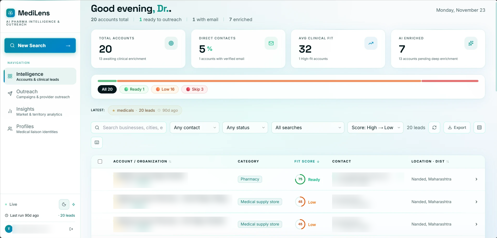

# MediLens: product case study

**AI pharma intelligence and outreach, built for the medical market.**
A product case study by **Prem Patil, Product and Project Manager** (idea, plan, requirements and delivery lead).

> **Honest status:** built and deployed, **one internal test run** (20 pharmacies in one Indian city, 1 draft message). **No users, no launch, no results yet.** Nothing in this repository claims adoption or revenue. Security hardening was done on 23 Nov 2026 (details below). The source code is not published; this repository holds the product documents only.

| | |
|---|---|
| **What it is** | A web app that finds healthcare businesses on a map, enriches them with contact details, scores how reachable each one is, writes personalised outreach with an LLM, and lets a person review, edit and send it. |
| **Who it is for** | Pharma and medical-supply sales teams, medical science liaisons and healthcare distributors. A market product, not built for one client. |
| **My role** | Product and project manager: problem framing, scope, requirements, priorities, acceptance criteria, delivery coordination, risk. The engineering team built it. |
| **Stack** | Next.js 14, TypeScript, Supabase (Postgres and auth), an LLM API, a maps search API, Leaflet. |
| **Documented** | November 2026, from the as-built system (see "How to read this"). |

*Intelligence dashboard. Business names, phone numbers and emails are blurred.*

## How to read this

A PM normally writes some documents before the build (discovery, brief, PRD), some during it (decisions, risks) and some after it (test results, launch notes). **These documents were reconstructed after the build from the working system** (code, database schema, the deployed app, one test run). I have not back-dated anything. Each document opens with a header that says:

- **Belongs in:** the phase where a PM would normally write it.
- **Written:** when it was actually written (November 2026).
- **Evidence:** what it was derived from.
- **Confidence:** *Observed* (seen in the code or app), *Derived* (reasoned from what was observed) or *Hypothesis* (my assumption, not yet tested with users).

## Contents

| Folder | What is in it |
|---|---|
| [`00-journey`](00-journey/) | Timeline, and where each document sits in the PM lifecycle |
| [`01-discovery`](01-discovery/) | Problem, personas, jobs-to-be-done, competitor scan, opportunity |
| [`02-definition`](02-definition/) | One-page brief, PRD, user stories, scope, success metrics, roadmap, prioritisation |
| [`03-design`](03-design/) | User journey, wireframes, screenshots |
| [`04-architecture`](04-architecture/) | System architecture, data flow, sequence diagrams, data model, algorithms, API spec |
| [`05-delivery`](05-delivery/) | RACI, decision log, dependencies and cost, assumptions, risks |
| [`06-quality-launch`](06-quality-launch/) | Test plan, UAT checklist, privacy and compliance, launch checklist, runbook, known limitations |
| [`07-reference`](07-reference/) | Glossary, open questions, changelog |

## What I would do differently

Writing this after the build exposed gaps a PM would normally catch earlier: API endpoints that answered without a login, a database open to the public key, open sign-up, a missing table, and two different score formulas. I found the security ones on 23 November 2026 while documenting, fixed them the same day, and re-tested the live app (see [`06-quality-launch/known-limitations.md`](06-quality-launch/known-limitations.md)). A security review before the first deploy would have caught all of them.
